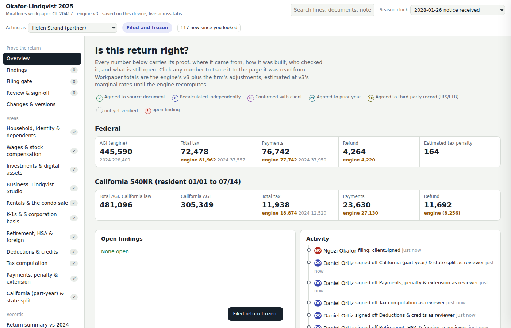
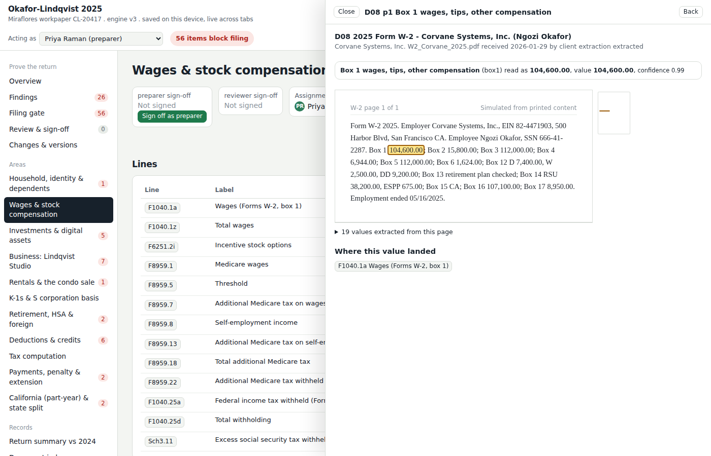
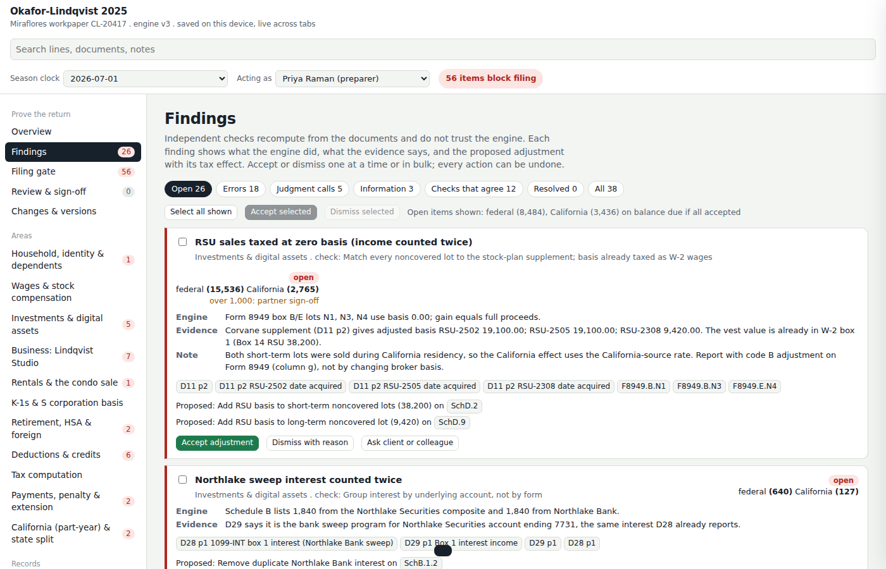

# Redesign the Tax Workpaper

A web-native tax workpaper for one complex household (Okafor-Lindqvist, 2025, MFJ, California to Texas mid-year), built from the purpose rather than from the spreadsheet.

- **Video walkthrough:** VIDEO-LINK
- **Core idea and data model (one page):** [docs/1-core-idea-and-data-model.md](docs/1-core-idea-and-data-model.md)
- **Errors found and how the design surfaced them:** [docs/2-errors-found.md](docs/2-errors-found.md)



## The idea in one paragraph

Every number on the return is a claim. A claim is proven when it has a source (a field on a page), a derivation (the engine rule and its inputs) and a verification (a tick mark: who checked it, how, against what). The workpaper shows which claims are proven, which are not, and what blocks filing. Click any number to see how it was built; click again to see the page it came from with the field highlighted.



## What it does

| Requirement | Where in the app |
|---|---|
| Trace any number to its source field; any document to everywhere it landed | Click any number; Document index |
| Record how each number was verified | Tick marks on every number; verification form in the trace drawer |
| Show how a number was built; reconcile figures | Computation tree in the trace; Sales detail (broker reconciliation); Books to tax |
| Hundreds of sales without swamping review | Sales detail: totals tie per broker, filter to flagged lots |
| Books to taxable income; state split | Books to tax; State split (Schedule CA columns A to E) |
| Checks that don't trust the engine | Findings: 19 errors, 5 judgment calls, 12 agreeing recomputations |
| Change without losing the original (who, why, tax effect) | Adjustments keep the engine value, reason, authority and federal / California effect |
| Live changes, "since I last looked", compare versions, what-ifs, bulk with undo | Changes & versions; What-ifs (engine alternatives plus sandbox); bulk accept with undo |
| Variance vs last year, judgments, elections, due diligence, completeness | Variance vs 2024; Judgments & elections; Document index; Filing gate |
| Questions that become evidence; review notes that block filing; sign-offs that reopen | Questions & messages; Review & sign-off (sign-offs hash what they cover) |
| Enforced roles, several people, assignments, client approval and e-file signature | Role switcher (8 users); area assignments; client portal with 8879 PINs |
| Extension, e-file rejection, freeze, amend, notice response, roll forward | Filing, e-file, freeze; Notice response (Letter 566 package); Next year |
| Firm standards, masked sensitive data with view logs, time vs budget, search | Standards, access, time; global search |



## Run locally

Open the project folder in VS Code and choose **Terminal > New Terminal**. From the folder containing `index.html`, run:

```powershell
python -m http.server 8000
```

If `python` isn't recognized, run `py -m http.server 8000` instead. Open **http://localhost:8000/** in your browser and leave the terminal running. You can also use the VS Code **Live Server** extension.

Don't double-click `index.html`: browsers block its data fetch when opened from `file://`.

## Architecture

```
index.html            loads data/packet.json (unmodified), then the scripts in order
data/packet.json      the packet exactly as delivered
src/core.js           indices over the packet, append-only event ledger, derived state, independent checks, tax-effect math
src/ui-shared.js      UI state, season clock, tick marks, masking, source-document adapter, trace drawer
src/ui-gate-views.js  filing gate, sign-off hashing, overview, findings, areas, return summary
src/ui-records.js     documents, sales, depreciation, books to tax, rentals, state split, K-1s, carryovers, variance, prior preparer, people, review, changes, what-ifs
src/ui-filing-app.js  filing and e-file, notice response, next year, firm, client portal, render loop and event handlers
src/style.css
```

- **Evidence is immutable; everything the firm does is an event.** The workpaper is a fold over an append-only ledger. Undo, reversal, freeze and amendment are all events, never deletions.
- **Source documents sit behind an adapter** (`pages(docId)`, `locate(valueId)`), so real page images can replace the simulated pages without changing tracing.
- **No framework, no build step.** Vanilla JS so the app loads the packet as delivered from a static link.

## Known limits

- The engine cannot be rerun, so tax effects use each version's per-dollar rates (or the engine's own what-if when one exists). Downstream totals are estimates until the engine recomputes; the UI says so and flags threshold crossings.
- Saving uses browser storage, so work persists across reloads and syncs live across tabs on the same machine, but it is not shared between people or devices. The store is a single object (`Store` in `src/core.js`); swapping in a shared backend means replacing its `append` and `connect` methods.
- Not tuned for mobile.
- Reset demo data: act as Jo Kimura (firm administrator), open Standards, access, time, and clear the device ledger.

## How AI was used

I used Claude (Anthropic) as my main tool throughout. I directed the design (the workpaper-as-proof idea, the ledger model, which checks to build, and how reviewers should move through the app) and reviewed the output. Claude explored the packet with Python scripts, compared every extracted value against the printed page content, recomputed engine results to find the errors in [docs/2-errors-found.md](docs/2-errors-found.md), wrote most of the application code, and tested it headlessly with Playwright through a full season (findings, partner approval, sign-offs, client signature, e-file, freeze, and the 2028 notice). I verified the findings against the source documents before including them. I used Claude Code to fix bugs, format the code, and finalize the repo.
